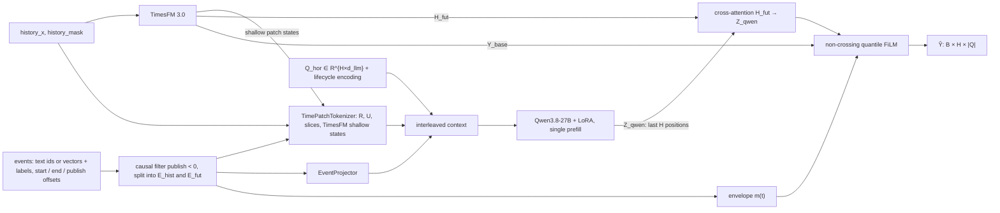
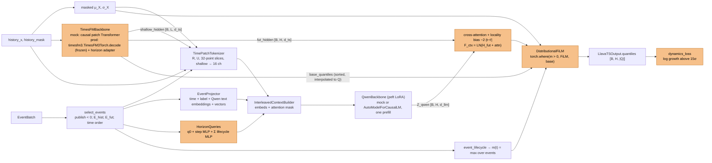

# LLaVA-TS Model: Original Design and Current Implementation

This document compares the original design in `task.md` with the code at commit `4c2cdb6` (Stage 3).

- **Section 1** describes the original design.
- **Section 2** describes the current implementation, one component at a time.
- **Section 3** lists all differences, with the reason for each difference.
- **Section 4** lists the limits of the current verification.

Each difference has one of these types:

| Type | Meaning |
|---|---|
| **Change** | The code does not do what `task.md` specifies. |
| **Interpretation** | `task.md` is silent or not clear. The code uses one possible meaning. |
| **Addition** | The code adds something that `task.md` does not mention. |

Open questions about the differences are in `check.md` (IDs C1–C7, S1–S10).

---

## 1. Original Design (`task.md`)

### 1.1 Idea
- Encode the real time-series jumps before and after each **history event** as continuous soft tokens `<TS_PATCH>`.
- Interleave these tokens with the event semantics in the context of **Qwen3.8-27B**. The LLM can then read the elasticity of the series from the history ("in-context few-shot").
- Append H learnable query tokens `<HORIZON_Q_1..H>`. One **prefill** pass (no autoregressive decode) gives one control vector per future step.
- These vectors drive a top adapter on **TimesFM 3.0** and a distribution-level **FiLM** affine transform.

### 1.2 Requirements
- Any history length L, any horizon H, any quantile set Q.
- Training targets: conditional distribution likelihood and time-series derivative dynamics only. No business metrics.
- Two modes:
  - `prod`: `transformers` `AutoModelForCausalLM` + `peft` `LoraConfig`, real Qwen3.8-27B and TimesFM 3.0 weights, BF16, gradient checkpointing.
  - `mac_debug` (default): pure-PyTorch mocks with the same structure and interface. `MockQwenCausalLM` (2 layers, d_llm = 128) and `MockTimesFM3Backbone` (2-layer patch Transformer, d_ts = 64).
- Lightning, Python ≥ 3.10.

### 1.3 Data flow (original)

### 1.4 Components (original)

| Component | Original specification |
|---|---|
| Input contract | `history_x`, `history_mask` [B, L]; `future_y`, `future_mask` [B, H] (training). Events: text token IDs or multi-vector semantics + discrete labels; `start_offset`, `end_offset`, `publish_offset` relative to t0 = 0. |
| Causal filter | Keep only events with `publish_offset < 0`. |
| E_hist | Events in [−L, 0), the N_hist most recent. |
| E_fut | Events whose extended lifetime [start − pre_buffer, end + post_buffer] meets [0, H), at most N_fut. |
| Jump features | MA(X) = moving period baseline; σ_X = max(Std(X), 1e-5) ("robust std"); R(t) = (X − MA) / σ_X; U(t) = ln((max(X, 0) + 0.1σ) / (max(MA, 0) + 0.1σ)). |
| History patch tokens | For each history event, slice [pre-event, in-event, post-event] of [R, U] + TimesFM shallow patch states → multi-scale 1D conv + adaptive pooling + 2-layer MLP (`TimeToLLMProjector`) → P = 4 tokens `<TS_HIST_PATCH>`. |
| Recent tokens | Recent state before t0 → P = 4 tokens `<TS_RECENT_PATCH>`. |
| Context order | [E_series_stat, (EventSem(e_hist_i), TSPatch(e_hist_i))…, TSRecent, EventSem(e_fut_j)…, Q_hor_1..H] in strict time order. |
| Query tokens | Learnable base Q_hor ∈ R^{H×d_llm} + lifecycle encoding per future step: time to event start / end, phase (warm-up / burst / decay / overdraft), intraday sin/cos. |
| Prefill | One forward pass over `inputs_embeds`; Z_qwen = top hidden states at the last H positions. |
| Cross-attention | Separate learnable W_Q, W_K, W_V; H_fut attends to Z_qwen; output F_ctx [B, H, d_ts]. |
| Envelope m(t) | 1 in the event; exp(−\|Δt\| / τ_buf) in the buffers; 0 with no coupled event. |
| FiLM heads | u = α_max · tanh(Linear_u(F_ctx)), α_max = 2.5; β = Linear_β(F_ctx); s = Softplus(Linear_s(F_ctx)) + 0.1. Output weights N(0, 1e-3). |
| FiLM output | Ŷ_0.5 = Ŷ_0.5,base · exp(m·u) + m·β·σ_X; Ŷ_q = Ŷ_0.5 + Δ_q,base · exp(m·u) · (1 + m(s − 1)). With m = 0, Ŷ = Ŷ_base exactly. |
| L_quantile | Pinball on (Y − μ_X) / σ_X, all quantiles; "Huber soft transition" only for \|e\| > 15σ; 100% linear otherwise. No arcsinh. |
| L_dynamics | Pinball on first differences (all quantiles) + Smooth-L1 on the median second difference. |
| L_cf | Where m > 0: Smooth-L1(u_0.5, u*), u* = clip(ln((max(Y, 0) + 0.1σ) / (max(Ŷ_0.5,base, 0) + 0.1σ)), −2.5, 2.5). |
| Total | L_quantile + λ1 · L_dynamics + λ2 · L_cf. |
| Tests | (1) H = 12/24/72/96 shapes; (2) zero-event max error = 0.0; (3) unpublished events have no effect; (4) non-zero, finite gradients for LoRA, tokenizer, Q_hor, FiLM; (5) **50 training steps**: separate 3.5× from 1.0× elasticity with the same event text; fit the pre-event dip, the step and the wider quantiles. |

---

## 2. Current Implementation

### 2.1 Data flow (current)
The changed parts are shown in orange (see Section 3).

### 2.2 Environment
| Item | Implementation |
|---|---|
| Python / packages | `.venv` (uv), Python 3.10.11, torch 2.14.1, lightning 2.6.6, peft 0.21.2, transformers 5.20.1, `timesfm[torch]` from GitHub (contains `timesfm3`). See `requirements.txt`. |
| Lightning | Only in `train_demo.py` (`LlavaTSLightning`). All model code is plain `nn.Module`. |
| Devices | CPU and Apple MPS. Tests run on CPU, so the results are deterministic. |

### 2.3 Configuration (`configs/model_config.py`)
- `ModelConfig` dataclass. `mode="mac_debug"` is the default. `ModelConfig.prod()` sets `mode="prod"`, `bf16=True` and `gradient_checkpointing=True`.
- `__post_init__` makes sure that `quantiles` contains 0.5. The FiLM needs the median.
- Default Q = (0.1, 0.25, 0.5, 0.75, 0.9); H = 24 (any H works in `forward`).
- Model IDs: `Qwen/Qwen3.8-27B` (placeholder) and `google/timesfm-3.0-pytorch`.
- Added fields: `slice_len = 32`, `lambda_dyn = 0.5`, `lambda_cf = 0.5`, `huber_sigma = 15.0`, `tau_buf = 1.5`, `pre_buffer = post_buffer = 3`, `ma_window = 24`, `recent_len = 48`, `period = 24`.

### 2.4 Data (`data/`)
- `EventBatch` and `MultimodalTSBatch` dataclasses, as specified. `event_mask` marks padding. `text_ids` / `text_mask`, `sem_vecs` [B, E, K, D] and `labels` are all optional.
- `make_elasticity_batch()`:
  - Base level 10 + 2·sin(2πt / 24 + random phase), with 5% multiplicative noise.
  - 3 history events and 1 future event. All events use the same text tokens.
  - Event factor = 1 − 0.15·A·(pre-event ramp) + A·(two Gaussian peaks at 30% and 70% of the duration), with A ∈ {3.5, 1.0}. Samples alternate between the two values of A.

### 2.5 Qwen backbone (`backbones/qwen_backbone.py`)
- **`MockQwenCausalLM`:** pure PyTorch, with RoPE, RMSNorm, SwiGLU and the Hugging Face module names (`q_proj`, `k_proj`, `v_proj`, `o_proj`, …). It has the same `forward(input_ids | inputs_embeds, attention_mask, position_ids, output_hidden_states, logits_to_keep)` interface. Each position may always attend to itself, so padded rows do not give NaN.
- **`QwenBackbone`:** `peft.get_peft_model` with LoRA (r = 8 on q/k/v/o) in **both** modes.
  - `prod` calls `AutoModelForCausalLM.from_pretrained` (BF16, non-reentrant gradient checkpointing).
  - `forward` computes `position_ids` from the mask, calls the model with `logits_to_keep=1`, and returns the last hidden layer.

### 2.6 TimesFM backbone (`backbones/timesfm_backbone.py`)
The output is `TimesFMOutput(shallow_hidden [B, L, d_ts], fut_hidden [B, H, d_ts], base_quantiles [B, H, |Q|])`.

- **Mock:**
  - Input steps: normalize by the masked μ / σ, then left-pad to whole patches (patch = 8).
  - Patch embedding: an MLP on [values, mask], plus sinusoidal positions. Then a causal `TransformerEncoder`.
  - `fut_hidden` = the last patch state + horizon MLP(sinusoidal(step)).
  - Base quantiles = μ + σ · (median + Φ⁻¹(q) · softplus(spread)). This works for any Q and the quantiles cannot cross. The mock is **trainable**.
- **Prod:**
  - One call to `timesfm3.TimesFM3Torch.decode(target, horizon, mask, return_aux_outputs=True)`. TimesFM weights are frozen.
  - `shallow_hidden` = `transformer_input` of the context patches, repeated to each time step.
  - `fut_hidden` = `transformer_output` of the patch token that forecasts each step (token n_ctx − 1 + k for steps [32k, 32k + 32)), plus a **trainable horizon adapter** (MLP on the step encoding).
  - Base quantiles: the native 9 levels, **sorted**, then linearly **interpolated** to Q.
  - Checked on the local checkpoint: the output is equal to `TimesFM3Forecaster.predict()` (maximum difference 0.0).

### 2.7 Time patch tokenizer (`models/time_patch_tokenizer.py`)
- MA = a **trailing** masked mean over 24 steps. σ_X = the masked population std, clamped to ≥ 1e-5. R and U are calculated as specified.
- TimesFM shallow states are compressed to 16 channels with a linear layer.
- Each history event slice [start − pre, end + post) is sampled on a **fixed grid of 32 points**. Each point has these channels:
  - R, U and 16 shallow channels,
  - a phase one-hot (pre / in / post),
  - a valid flag.
  
  That is 22 channels in total. `TimeToLLMProjector` (conv kernels 3/5/9, width 64, GELU, adaptive pooling to P = 4, 2-layer MLP) maps them to 4 tokens.
- The recent window is the last 48 steps, with the same channels (phase = 0). A separate projector maps it to 4 tokens.
- One stat token = MLP([μ/σ, ln σ, R_last, U_last]).

### 2.8 Event selection and semantic tokens (`models/interleaved_context.py`)
- **`select_events`:**
  - visible = `event_mask` and `publish_offset < 0`.
  - E_hist = start in [−L, 0), top N_hist by start (the most recent).
  - E_fut = (start − pre < H) and (end + post > 0), the N_fut earliest.
  - Both sets are sorted in time order. One event can be in both sets.
- **`EventProjector`:** for each event, these tokens:
  - one time token (MLP of sinusoidal(start, end, duration, publish)),
  - one label token (if labels are given),
  - the **Qwen input embeddings of the text tokens** (if text is given),
  - one token per semantic vector, made by an MLP (if vectors are given).
- Padded and unpublished events become **masked tokens** (`attention_mask = 0`, value 0). Their values cannot change the output.

### 2.9 Horizon queries (`HorizonQueries`)
Q_hor(t) = q0 + StepMLP([sinusoidal(t), sin / cos(2πt / period)]) + Σ_j valid_j · LifeMLP([sinusoidal(t − start_j), sinusoidal(t − end_j), phase_j(t) one-hot (4), m_j(t)]).

q0 ∈ R^{d_llm} is the learnable base.

### 2.10 Interleaved context and prefill
- The order is the same as in the original design.
- The sequence is one fixed-shape tensor with a token mask.
- The H query tokens are always the last H positions, so Z_qwen = `hidden[:, -H:]`.

### 2.11 Envelope and FiLM (`models/distributional_film.py`)
- **`event_lifecycle`** gives the per-event envelope and the phase one-hot. m(t) is the maximum over the valid future events.
  - In the event, the envelope is 1.
  - In the buffers, it is exp(−d / τ_buf), with d = start − t before the event and d = t − end + 1 after it.
  - Phases: warm-up [start − pre, start), burst [start, mid), decay [mid, end), overdraft [end, end + post).
- **Cross-attention:**
  - `nn.MultiheadAttention(d_ts, kdim=d_llm, vdim=d_llm)`, which has separate W_Q, W_K and W_V.
  - The attention logits get the bias **−2.0 · |t − t'|**.
  - F_ctx = LayerNorm(H_fut + attention output).
- **Heads:** u, β and s as specified. Weights start as N(0, 1e-3) and biases as 0, except the `Linear_s` bias, which is ln(e^0.9 − 1). Then s = 1.0 at the start.
- **Output:** the FiLM formula as specified. Then `torch.where(m > 0, FiLM output, base)`.

### 2.12 Loss (`losses/dynamics_loss.py`)
- Normalized space: (Y − μ_X) / σ_X. No arcsinh.
- Robust pinball: ρ(e) = |e| for |e| ≤ 15; ρ(e) = 15 · (1 + ln(|e| / 15)) above. The result is weighted with q or 1 − q.
- Velocity: robust pinball on the first differences of all quantile paths.
- Curvature: Smooth-L1 on the median second difference.
- Differences are computed only inside the forecast window.
- L_cf: as specified. The target uses `base_median.detach()`.
- Total = L_quantile + 0.5 · (velocity + curvature) + 0.5 · L_cf.

### 2.13 Training demo and tests
- **`train_demo.py`:**
  - AdamW, lr 4e-3, batch 32. A new synthetic batch at each step.
  - The default is 50 steps. `--steps` and `--accelerator` are available.
  - `elasticity_report()` measures a held-out batch (seed 10000).
- **`tests/test_model_mechanics.py`:** the 5 tests (8 test results). Test 5 trains **100 steps** and checks:
  - loss after < 0.6 × loss before,
  - u_hi − u_lo > 0.2,
  - warm-up shift < 0,
  - width ratio > 1.0.
- **Result:** 8 passed in 18 s.
- **Measured** (held-out batch):

  | Run | Loss | u_hi / u_lo | Warm-up shift | Width ratio | Event MAE / base |
  |---|---|---|---|---|---|
  | MPS, 50 steps | 1.00 → 0.65 | 0.54 / 0.51 | −0.31σ | 2.9 | 0.42 |
  | CPU, 100 steps | 1.00 → 0.34 | 0.73 / 0.34 | −0.32σ | 1.3 | 0.21 |

---

## 3. Differences and Reasons

### 3.1 Changes

| ID | Area | Original | Current | Reason | check.md |
|---|---|---|---|---|---|
| D1 | Prod TimesFM loader | `transformers` loads TimesFM 3.0 | Official `timesfm3.TimesFM3Torch`, installed from GitHub | The checkpoint `google/timesfm-3.0-pytorch` uses the native `timesfm3` format (variate attention, CPM iterative RevIN, output patch 64). Transformers cannot load it. `timesfm3` is not on PyPI. The output is equal to the official forecaster (difference 0.0). | S2 (confirmed) |
| D2 | Cross-attention | Full attention: each future step attends to all H Z_qwen states | Same attention, plus the logit bias −2.0 · \|t − t'\| | With full attention, the phase information of step t is mixed with the other steps. After 50 steps, the warm-up shift was +0.41σ (wrong sign) and the loss only fell to 0.92. With the bias: −0.31σ and 0.65. A strict one-step mask gives zero gradients to W_Q and W_K (test 4 fails). A band of ±1 to ±3 steps and a residual path were weaker. | C2 (open) |
| D3 | Test 5 duration | 50 steps | 100 steps (`TEST5_STEPS`); the demo default is still 50 | At 50 steps, the hi − lo gap in u is 0.04 / 0.19 / 0.00 (seeds 0 / 1 / 2). At 100 steps it is 0.39 / 0.31 / 0.58. A linear probe on Z_qwen separates hi from lo with 100% accuracy before training, so the signal is present. The readout needs more steps. | C1 (open) |
| D4 | Query token base | Q_hor ∈ R^{H×d_llm} (one parameter row for each step) | One learnable vector q0 + an MLP of the step encoding | A fixed H × d matrix does not support "any H". q0 + step MLP works for every H, including H values that training did not use. | C7 (open) |
| D5 | Soft transition above 15σ | "Huber soft transition" | Log growth: 15 · (1 + ln(\|e\| / 15)) | A true Huber loss is quadratic near 0, which conflicts with "100% linear gradient in the normal range". A linear pinball loss already has bounded gradients. Log growth keeps the value and the slope continuous at 15σ and reduces the gradient as 15 / \|e\| for outliers. | C3 (open) |
| D6 | Zero-event identity | Algebraic identity of the formula at m = 0 | `torch.where(m > 0, FiLM output, base)` | In floating point, a + (b − a) is not always equal to b. Test 2 requires an error of exactly 0.0. Where m > 0, the values are the same as the formula, and the gradients are the same. | S8 (open) |
| D7 | Learning rate | Not specified | 4e-3 | lr 2e-2 and above diverged; 4e-3 was the best value at 50 steps. | C5 (open) |

### 3.2 Interpretations (`task.md` is silent or not clear)

| ID | Area | Implementation | Reason | check.md |
|---|---|---|---|---|
| I1 | Mock TimesFM training | The mock is trainable. In prod, the TimesFM weights are frozen and only the horizon adapter trains. | A frozen mock with random weights gives a useless base forecast. Prod keeps the pretrained forecast and the exact zero-event identity to TimesFM. | S1 (confirmed) |
| I2 | LoRA in mac_debug | `peft` LoRA on the mock Qwen | The same LoRA code runs in both modes. | S3 (confirmed) |
| I3 | Test 4 LoRA check | Checks `lora_B` | `peft` sets lora_B = 0 at the start, so lora_A has a zero gradient at step 1. | S4 (confirmed) |
| I4 | H_fut source | Mock: last patch state + horizon MLP. Prod: the patch token that forecasts each step + horizon adapter. | `task.md` does not define how a per-step future state comes from TimesFM. In TimesFM 3, patch token n_ctx − 1 + k forecasts steps [32k, 32k + 32). | — |
| I5 | Quantile set Q | Mock: Φ⁻¹(q) spread. Prod: sort the native 9 levels, then interpolate. Q must contain 0.5. | TimesFM 3 outputs fixed levels 0.1 … 0.9. Sorting follows `TimesFM3Forecaster`. The FiLM needs the median. Levels outside [0.1, 0.9] are clamped in prod. | — |
| I6 | Events in both sets | An event that starts before t0 and lasts into [0, H) is in E_hist and E_fut. | Its history part shows the observed response, and its future part drives m(t). | S5 (open) |
| I7 | E_fut order | The N_fut earliest events by start | `task.md` gives only "at most N_fut". | — |
| I8 | Phases | Warm-up = pre-buffer; burst = first half of the event; decay = second half; overdraft = post-buffer | `task.md` names four phases but does not define them. | S6 (open) |
| I9 | Envelope distance | Before: start − t. After: t − end + 1 (end is exclusive). | This makes the two buffers symmetric for integer offsets. | — |
| I10 | MA(X) | Trailing masked mean, window = 24 | "Moving period baseline" does not say trailing or centered. Trailing uses only earlier values. | — |
| I11 | σ_X | Masked population std, clamped to ≥ 1e-5 | `task.md` says "robust std" but gives the formula max(Std(X), 1e-5). The code follows the formula; it is not a robust estimator (for example, MAD). | C6 (open) |
| I12 | Event slices | Fixed grid of 32 samples over [start − pre, end + post) | Events have different durations. A fixed grid gives one batch tensor and keeps the 3 phases in proportion. | — |
| I13 | Shallow states | Compressed to 16 channels before the conv | In prod, d_ts = 1280. Without compression, the shallow channels would hide R and U. | — |
| I14 | Stat token | MLP([μ/σ, ln σ, R_last, U_last]) | `task.md` does not define E_series_stat. | — |
| I15 | Text semantics | The Qwen input embeddings of the text tokens go directly into the context. A time token, a label token and vector tokens are added. | This is the LLaVA approach: the LLM reads the text itself. `EventProjector` maps only the non-text inputs. | — |
| I16 | F_ctx | LayerNorm(H_fut + attention output) | `task.md` gives only "fused representation". A residual keeps the TimesFM state. | — |
| I17 | s_spread start value | Bias ln(e^0.9 − 1), so s = 1.0 at the start | With a zero bias, s = 0.79, and the quantile range of event steps would be narrower before training. The weights still use N(0, 1e-3), as specified. | S7 (open) |
| I18 | Difference losses | Only inside [0, H) | The step from the last history value to t = 0 is not used. | C5 (open) |
| I19 | u* target | Uses `base_median.detach()` | u* is a target. The mock base must not learn to move toward u. | C5 (open) |
| I20 | λ1, λ2 | 0.5 / 0.5 | Not specified. | C5 (open) |
| I21 | Test 5 pass conditions | 4 relative assertions (Section 2.13) | "Precise fit" is not measurable. You chose relative checks. | C4 (open) |
| I22 | Intraday encoding | sin / cos of 2πt / 24, with t counted from t0 | The schema has no time of day for t0. | S9 (open) |

### 3.3 Additions

| ID | Addition | Reason |
|---|---|---|
| A1 | `ModelConfig.__post_init__` checks that 0.5 is in Q. | The FiLM needs the median. |
| A2 | `slice_len`, `huber_sigma`, `lambda_dyn`, `lambda_cf` in the config | These are the values for I12, D5 and I20. |
| A3 | `ndtri` is computed on CPU in the mock TimesFM. | MPS has no kernel for `torch.special.ndtri`. |
| A4 | The mock Qwen lets each position attend to itself. | Rows that are fully masked would give NaN. |
| A5 | `elasticity_report()` also prints `event_mae_ratio_hi`. | It shows the impulse fit. It is not asserted. |
| A6 | `check.md`, `log.md`, `requirements.txt`, `.gitignore`, and one commit per stage | Project rules and traceability. |

---

## 4. Verification Limits

1. **Prod Qwen was not run.** The 54 GB weights are not on this machine. The ID `Qwen/Qwen3.8-27B` is a placeholder. The `prod` Qwen path (`AutoModelForCausalLM`, BF16, gradient checkpointing, `logits_to_keep=1`) has the same interface as the mock, but it has no test.
2. **Prod TimesFM was run on CPU only,** as a backbone. The full model was not run in `prod` mode.
3. **Offline loading:** on this machine, the Hugging Face Hub client tries a SOCKS proxy and fails. To load offline, set `timesfm_model_id` to the local snapshot folder (S10).
4. **Mock results only:** all training results come from the 2-layer mocks on synthetic data. They show that the mechanism works. They do not show how the real 27B model behaves.
