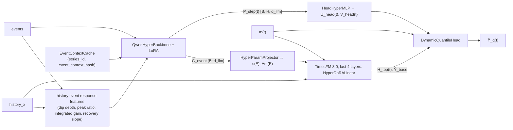
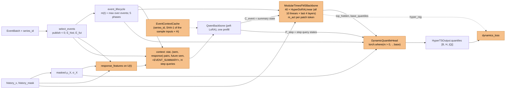

# HyperLoRA Model (Scheme 2): Original Design and Current Implementation

This document compares the Scheme 2 design in `task.md` with the code on branch `hyperlora` (Stage C).
The Scheme 1 (LLaVA-TS) version of this document is on branch `main`.

- **Section 1** describes the original design.
- **Section 2** describes the current implementation.
- **Section 3** lists all differences, with the reason for each difference.
- **Section 4** lists the limits of the current verification.

Each difference has one of these types:

| Type | Meaning |
|---|---|
| **Change** | The code does not do what `task.md` specifies. |
| **Interpretation** | `task.md` is silent or not clear. The code uses one possible meaning. |
| **Addition** | The code adds something that `task.md` does not mention. |

Open questions are in `check.md` (IDs H1–H23 for Scheme 2; C3, C6 carried over from Scheme 1).

---

## 1. Original Design (`task.md`)

### 1.1 Idea
- **Qwen3.8-27B** is an event-conditioned hypernetwork. It reads the history elasticity and the current event combination.
- For each sample, it generates two things in real time:
  - dynamic singular values Σ(E) for the linear modules of the **last 4 TimesFM 3.0 layers** (Hyper-DoRA),
  - per-step low-rank weights ΔW_head(E, t) for the output head.
- The goal is "one operator per event, zero drift without events".
- Static LoRA / DoRA drifts outside event windows, and a frozen head cannot express large pulses. Scheme 2 solves both.

### 1.2 Requirements
- Any horizon H, any sampling frequency, any quantile set Q.
- Training targets: conditional distribution likelihood and difference dynamics only. No business metrics.
- Two modes:
  - `prod`: Hugging Face Qwen3.8-27B + PEFT LoRA, and the official TimesFM 3.0.
  - `mac_debug` (default): pure-PyTorch `MockQwenCausalLM` and `ModularTimesFM3Backbone`, a mock that accepts dynamic layers.

### 1.3 Data flow (original)

### 1.4 Components (original)

| Component | Original specification |
|---|---|
| Qwen input | Base series statistics + (history event semantics, real response features) pairs + future coupled event semantics and time topology. Response features relative to the moving period baseline: dip depth, peak ratio, integrated gain over the event, recovery slope. |
| Qwen outputs | C_event ∈ R^{B×d_llm} (for the TimesFM block modulation); P_step(t) ∈ R^{B×H×d_llm}, combined with the lifecycle position of each step (warm-up / burst / sustain / tail / overdraft), for the head weights. |
| EventContextCache | Feature cache indexed by (series_id, event_context_hash). It avoids repeated 27B forward passes in inference or in a frozen-feature phase. |
| HyperDoRALinear | Replaces `nn.Linear` in the last N_last (= 4) TimesFM layers. Frozen W0, b0 and row norm m0 = ‖W0‖_row. Shared A ∈ R^{r×d_in} (Kaiming) and B ∈ R^{d_out×r} (N(0, 0.02), **not zero**). `HyperParamProjector`: C_event → s(E) ∈ R^{B×r} and Δm(E) ∈ R^{B×d_out}, weights N(0, 1e-3), bias 0. |
| HyperDoRA forward | y0 = h W0ᵀ + b0; Δy = ((h Aᵀ) ⊙ s(E)) Bᵀ; y = (1 + m_act ⊙ tanh(Δm(E))) ⊙ y0 + m_act ⊙ Δy. With m_act = 0, y ≡ y0. |
| DynamicQuantileHead | `HeadHyperMLP`: P_step(t) → U_head(t) ∈ R^{B×H×d_ts×r_h}, V_head(t) ∈ R^{B×H×r_h×3}. [ũ, β, s̃] = bmm(bmm(H_top(t), U), V). u = 2.5 tanh(ũ), s = Softplus(s̃) + 0.1. |
| Quantile composition | Ŷ_0.5 = Ŷ_0.5,base · exp(m u) + m β σ_X; Ŷ_q = Ŷ_0.5 + (Ŷ_q,base − Ŷ_0.5,base) · exp(m u) · (1 + m(s − 1)). |
| Loss | L = L_linear-pinball + λ1 L_diff-1st + λ2 L_diff-2nd + λ3 L_cf + λ_reg (‖s(E)‖² + ‖Δm(E)‖²), in (Y − μ_X) / σ_X, no arcsinh. |
| Tests | (1) m = 0 → error vs. native TimesFM 3.0 exactly 0.0; (2) batched HyperDoRA = per-sample W_eff = W0 + B Diag(s_b) A, error < 1e-6; (3) gradients > 0, no NaN for Qwen LoRA, A, B, projector, head; (4) cache hit = miss, quantiles strictly increasing for any positive or negative pulse; (5) **50 steps** on series with warm-up dip, onset spike, exponential decay and overdraft: the loss converges fast, and the same event gives clearly different pulses for different elasticities. |

---

## 2. Current Implementation

### 2.1 Data flow (current)
The parts that differ from or extend the original are shown in orange (see Section 3).

### 2.2 Environment and files
| Item | Implementation |
|---|---|
| Packages | `.venv` (uv): Python 3.10.11, torch 2.14.1, lightning 2.6.6, peft 0.21.2, transformers 5.20.1, `timesfm[torch]` from GitHub (contains `timesfm3`). |
| Files | `configs/model_config.py`, `data/{schema,synthetic_generator}.py`, `backbones/{qwen_hyper_backbone,timesfm_modular}.py`, `models/{hyper_dora_linear,dynamic_quantile_head,hyper_timesfm_model}.py`, `losses/dynamics_loss.py`, `tests/test_hyper_mechanics.py`, `train_demo.py` — the layout in `task.md`. |
| Lightning | Only in `train_demo.py` (`HyperTSLightning`). All model code is plain `nn.Module`. |
| Size (mac_debug) | 1.45 M parameters, 0.61 M trainable. |

### 2.3 Configuration
`ModelConfig` defaults:

| Group | Values |
|---|---|
| Output | Q = (0.1, 0.25, 0.5, 0.75, 0.9) (must contain 0.5); H = 24 (any H works) |
| Mock Qwen | d_llm = 128, 2 layers, LoRA r = 8 on q/k/v/o |
| Mock TimesFM | d_ts = 64, 4 layers, patch length 8 |
| HyperLoRA | `n_last_layers = 4`, `hyper_rank = 8` (r), `head_rank = 4` (r_h) |
| Events | N_hist = N_fut = 4, pre_buffer = post_buffer = 3, τ_buf = 1.5, ma_window = 24, period = 24, α_max = 2.5 |
| Loss | λ1 = λ2 = λ3 = 0.5, λ_reg = 1e-3, Huber threshold 15 |

`ModelConfig.prod()` sets BF16 and gradient checkpointing.

### 2.4 Qwen hypernetwork (`backbones/qwen_hyper_backbone.py`)
- **Mock and LoRA:** `MockQwenCausalLM` and `QwenBackbone` are the same as in Scheme 1 (RoPE, RMSNorm, SwiGLU, HF module names, peft LoRA in both modes).
- **`select_events`:**
  - keeps only events with `publish_offset < 0`,
  - E_hist = start in [−L, 0), the 4 most recent,
  - E_fut = [start − pre, end + post] meets [0, H), the 4 earliest,
  - both sets in time order.
- **`event_lifecycle`:**
  - envelope: 1 in the event, exp(−d / τ_buf) in the buffers, else 0,
  - 5 phases: warm-up = pre-buffer; burst / sustain / tail = thirds of the event; overdraft = post-buffer.
- **`response_features`** are computed on U(t) = ln((max(X,0) + 0.1σ) / (max(MA,0) + 0.1σ)), with MA = trailing masked mean over 24 steps:
  - dip depth = min U in the pre-buffer,
  - peak ratio = max exp(U) in the event,
  - integrated gain = Σ U in the event,
  - recovery slope = mean ΔU in the post-buffer.

  It also gives the stat features [μ/σ, ln σ, R_last, U_last].
- **Context:** [stat token, for each history event (semantic tokens, response token), future event semantic tokens, `<EVENT_SUMMARY>`, Q_1..Q_H].
  - Semantic tokens: a time-topology token (sinusoidal start / end / duration / publish), a label token, the Qwen text embeddings, and vector tokens.
  - Step query Q_t = q0 + StepMLP(step, intraday sin/cos) + Σ_j LifeMLP(t − start_j, t − end_j, 5-phase one-hot, m_j(t)).
  - Padded and unpublished events are masked tokens.
- **Outputs:** C_event = the top state of `<EVENT_SUMMARY>`. P_step = the top states of the H queries.
- **`EventContextCache`:**
  - key = (series_id, SHA-1 of all input tensors of the sample, and H), value = detached (C_event, P_step),
  - on any miss, the whole batch is encoded and stored, and then read from the cache.

### 2.5 HyperDoRALinear (`models/hyper_dora_linear.py`)
- **Parameters:** frozen `base` (W0, b0). A uses Kaiming-uniform init, and B ~ N(0, 0.02). `proj` = Linear(d_llm → r + d_out) with N(0, 1e-3) weights and zero bias; it gives s(E) and Δm(E).
- **Forward:** the input is reshaped to [B, tokens, d_in]. Then y = (1 + m_act · tanh(Δm)) · y0 + m_act · ((h Aᵀ) · s) Bᵀ, with broadcasting and matmul. There is no loop over samples.
- **`HyperCondition`** holds C_event, m(t), n_ctx, the patch length and the span. It maps m(t) to tokens: token n_ctx − 1 + k gets the max m(t) over [k·p, k·p + span). All context tokens before n_ctx − 1 get 0.
- **`inject_hyper_dora`** replaces every `nn.Linear` in the last N layers. **`hyper_condition`** is a context manager that sets and clears the condition.

### 2.6 Modular TimesFM 3.0 (`backbones/timesfm_modular.py`)
- **Mock (`MockTimesFM3Core`):**
  - Steps: RevIN-like normalization; patches of 8 steps; ceil(H/8) horizon patch tokens (value 0, valid flag 0); a resblock MLP and sinusoidal positions.
  - Layers: 4 `MockMixingLayer`s. Each has causal `seq_attn`, `var_attn` over one variate in the (b·n, 1, d) layout, and `ff0` / `ff1`, all with the TimesFM 3 names.
  - Output head: Linear(d → 2p). Token n_ctx − 1 + k forecasts patch k. Base quantiles = μ + σ(median + Φ⁻¹(q) · softplus(spread)).
- **Prod (`ProdTimesFM3Core`):**
  - frozen `TimesFM3Torch`, called with `decode.__wrapped__` (without `@torch.no_grad`) and `return_aux_outputs=True`,
  - `top_hidden` = `transformer_output` of the forecasting token for each step,
  - the native 9 quantiles are sorted and interpolated to Q,
  - span = 64 (stitching).
- **`ModularTimesFM3Backbone`** puts in 40 `HyperDoRALinear` modules. Without `c_event`, it is the native TimesFM.

### 2.7 Dynamic quantile head (`models/dynamic_quantile_head.py`)
- `HeadHyperMLP` = Linear(d_llm, d_llm) → GELU → Linear(d_llm, d_ts·r_h + 3·r_h). Its output gives U [B, H, d_ts, r_h] and V [B, H, r_h, 3].
- Init: last-layer weights N(0, 1e-3); bias U-part N(0, 1/d_ts), V-part N(0, 1e-2).
- [ũ, β, s̃] = (H_top U) V. u = 2.5 tanh ũ; s = Softplus(s̃) + 0.1 (no bias, as specified).
- The composition is as specified, then `torch.where(m > 0, ·, base)`.

### 2.8 Loss (`losses/dynamics_loss.py`)
- **L_pinball:** pinball on all quantiles in the space (Y − μ_X) / σ_X. Linear up to 15σ, then 15 · (1 + ln(|e| / 15)).
- **L_diff1:** the same pinball on the first differences of all quantile paths.
- **L_diff2:** Smooth-L1 on the median second difference.
- **L_cf:** Smooth-L1(u_0.5, clip(ln((max(Y,0) + 0.1σ) / (max(Ŷ_0.5,base,detached, 0) + 0.1σ)), ±2.5)) where m > 0.
- **Regularizer:** `hyper_reg` = mean over samples of Σ over the 40 layers of (‖s‖² + ‖Δm‖²).
- **Total:** L_pinball + 0.5 L_diff1 + 0.5 L_diff2 + 0.5 L_cf + 1e-3 · reg.

### 2.9 Synthetic data, demo, tests
- **Generator:**
  - base 10 + 2 sin(2πt / 24 + random phase), with 5% noise,
  - 3 history events + 1 future event, all with the same text,
  - factor = 1 − 0.15·A·(warm-up ramp) + A·exp(−(t − start) / (duration / 3)) in the event − 0.1·A·exp(−(t − end) / 1.5) in the post-buffer,
  - A ∈ {3.5, 1.0}, and `series_id = "entity-b-xA"`.
- **Demo:** AdamW, lr 1e-3, batch 32, a new batch at each step, 50 steps by default. `elasticity_report()` measures a held-out batch (seed 10000).
- **Tests:** 9 results in 16 s:
  - test 1 for H = 12, 24 and 96,
  - test 2,
  - the mock backbone identity and locality check,
  - the prod TimesFM 3.0 identity and gradient check (skipped without the checkpoint),
  - tests 3, 4 and 5.
- **Test 5** (50 steps, seed 0) checks:
  - loss < 0.5 × start,
  - u_hi > 1.5 · u_lo > 0,
  - warm-up shift < 0,
  - overdraft shift < 0,
  - width ratio > 1.

  **Measured** at 50 steps, lr 1e-3:

  | Run | Loss after / before | u_hi / u_lo | Warm-up | Overdraft | Width ratio |
  |---|---|---|---|---|---|
  | CPU, seeds 0–3 | 0.29–0.37 | 1.86–2.35 | −0.27 to −0.41σ | −0.12 to −0.28σ | 1.24–1.39 |
  | MPS, seed 0 | 0.29 | 0.51 / 0.27 | −0.35σ | −0.15σ | 1.37 |

---

## 3. Differences and Reasons

### 3.1 Changes

| ID | Area | Original | Current | Reason | check.md |
|---|---|---|---|---|---|
| D1 | Row norm m0 | Frozen m0 = ‖W0‖_row is a parameter | Not stored | The specified formula uses only the relative gain (1 + m_act tanh Δm). m0 would never be used. | H13 (open) |
| D2 | Number of variates | Not limited | One variate only (no covariates) | The real TimesFM calls its linears with flattened layouts (b·v, n, d), (b·n, v, d), (b, v, n, d). With v = 1, all three reshape to [B, tokens, d] in the same token order, so per-sample weights are correct. | H3 (open) |
| D3 | Head identity at m = 0 | Algebraic identity | `torch.where(m > 0, FiLM output, base)` | In floating point, a + (b − a) is not always b. Test 1 requires exactly 0.0. The values where m > 0 are the same. HyperDoRA is exact without this step. | H11 (confirmed) / S8 |
| D4 | Cache and gradients | Not specified | With a cache, misses also return the detached cached values | A miss and a hit give the same tensors (test 4). No gradient reaches Qwen when a cache is used. This matches the "inference or frozen-feature phase". | H20 (info) |
| D5 | Soft transition above 15σ | "Huber" transition | Log growth 15 · (1 + ln(\|e\| / 15)) | A true Huber loss is quadratic near 0. This conflicts with "linear in the normal range", and a linear pinball loss already has bounded gradients. | C3 (open) |
| D6 | Learning rate | Not specified | 1e-3 | At 50 steps, lr 1e-3 passed every check on seeds 0–3. lr 3e-3 lost the elasticity separation, and 8e-3 diverged. | H21 (open) |

### 3.2 Interpretations

| ID | Area | Implementation | Reason | check.md |
|---|---|---|---|---|
| I1 | Layers to replace | All 10 linears per layer: `seq_attn` q/k/v/out, `var_attn` q/k/v/out, `ff0`, `ff1` (40 modules) | You chose this. | H2 (confirmed) |
| I2 | Scheme 1 code | Replaced on this branch; reused parts moved into the Scheme 2 files | You chose this. Scheme 1 stays on `main`. | H1 (confirmed) |
| I3 | m_act per patch token | Token n_ctx − 1 + k gets max m(t) over the steps that it forecasts; earlier context tokens get 0 | `task.md` gives m_act per token but no mapping. The history processing stays unchanged. In the mock, forecast patches before the first event token are exactly unchanged. | H4 (open) |
| I4 | Gradients through prod TimesFM | `TimesFM3Torch.decode.__wrapped__` | `decode` has `@torch.no_grad`. The frozen TimesFM weights still get no gradient. This depends on an internal detail of `timesfm3`. | H5 (open) |
| I5 | Mock TimesFM | TimesFM 3 module names and horizon patch tokens | The same replacement code runs in both modes. | H6 (open) |
| I6 | C_event and P_step | Top states of `<EVENT_SUMMARY>` and of the H step queries, from one prefill | `task.md` does not say where the two codes come from. | H7 (open) |
| I7 | Response features | min U, max exp(U), Σ U, mean ΔU in the pre / in / post windows | `task.md` names the 4 features but does not define them. | H8 (open) |
| I8 | Five phases | Warm-up = pre-buffer; burst / sustain / tail = thirds; overdraft = post-buffer | `task.md` names them but does not define them. | H9 (open) |
| I9 | Cache key | (series_id, SHA-1 of the sample inputs and H) | "event_context_hash" is not defined. The input tensors define the context completely. | H10 (open) |
| I10 | Mock training | The mock TimesFM is trainable except W0 / b0 in the HyperDoRA modules. Prod is fully frozen. | A frozen random mock gives a useless base. | H14 (open), S1 |
| I11 | Head init | Weights N(0, 1e-3); bias: U part N(0, 1/d_ts), V part N(0, 1e-2) | If U and V both start near 0, the bilinear head has almost no gradient at step 1. | H17 (open) |
| I12 | Spread start value | No bias, so s starts near 0.79 | As specified. | H11 (confirmed) |
| I13 | Regularizer | Σ over layers, mean over samples | `task.md` does not say sum or mean. | H19 (open) |
| I14 | σ_X | Masked population std, ≥ 1e-5 | `task.md` says "robust" but gives the plain-std formula. | C6 (open) |
| I15 | Step query base | q0 + StepMLP(step encoding) | A fixed H × d matrix does not support any H. | C7 (open) |
| I16 | Event sets | One event can be in E_hist and in E_fut | Its history part shows the observed response, and its future part drives m(t). | S5 (open) |
| I17 | Intraday encoding | sin / cos of 2πt / 24, with t counted from t0 | The schema has no time of day for t0. | S9 (open) |
| I18 | Pulse shape | Ramp dip 0.15·A, spike A·exp decay (τ = duration / 3), overdraft 0.1·A·exp decay (τ = 1.5) | `task.md` names the stages but gives no shape. | H22 (open) |
| I19 | Test 5 checks | 5 relative assertions (Section 2.9) | "Clearly different" and "fast convergence" are not measurable. | H23 (open) |
| I20 | Test 1 reference | The same backbone without a condition | `HyperDoRALinear` without a condition calls the original `nn.Linear`. In prod this is the native TimesFM 3.0; in the mock it is the current mock weights. | — |

### 3.3 Additions

| ID | Addition | Reason |
|---|---|---|
| A1 | `MultimodalTSBatch.series_id` | The cache key needs it. |
| A2 | Backbone identity tests (mock locality and prod TimesFM 3.0 with gradients) | They check the HyperDoRA path on the real checkpoint. |
| A3 | `overdraft_shift_hi` and `event_mae_ratio_hi` in the report | They show the overdraft and the impulse fit. |
| A4 | `ModelConfig.__post_init__` checks that 0.5 is in Q | The head needs the median. |
| A5 | `ndtri` is computed on CPU in the mock | MPS has no kernel for `torch.special.ndtri`. |

---

## 4. Verification Limits

1. **Prod Qwen was not run.** The 27B weights are not on this machine. `Qwen/Qwen3.8-27B` is a placeholder ID.
2. **Prod TimesFM 3.0 was tested as a backbone on CPU:** 40 modules, exact identity at m = 0, gradients for A, B and the projector, and no gradient for W0. The full model was not run in `prod` mode.
3. **Parameter cost in prod:**
   - Each HyperParamProjector is Linear(d_llm → r + 1280). With d_llm = 5120, 40 projectors have about 264 M parameters.
   - The HeadHyperMLP output layer is Linear(5120 → 1280·4 + 12), about 26 M parameters.
4. **Offline loading:** on this machine, the Hugging Face Hub client tries a SOCKS proxy and fails. Set `timesfm_model_id` to the local snapshot folder (S10).
5. **Mock results only:** all training results come from the mocks on synthetic data. They show that the mechanism works. They do not show how the real 27B model behaves.
